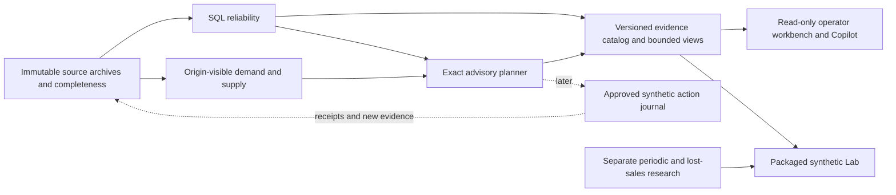

# Next implementation phases

Investigated 2026-10-12 (America/Los_Angeles), against main `b5b8d5a`.
Status: **proposed; investigation and planning only**. Nothing here resumes paused
features, assigns a new benchmark program, approves operational data or authorizes
deployment. [STATE](STATE.md) owns scope; [PLAN](PLAN.md) retains the unfinished
engineering confirmation protocol. This is the single pending product roadmap;
completed findings belong in [KB](KB.md#next-phase-investigation), measured results
in [RESULTS](RESULTS.md), and reference metadata in
[repositories.json](research/repositories.json).

## Recommendation and priorities

Build a **reliable, read-only inventory workbench** next. Let an operator identify
which SKU/location needs attention, understand the blocker, inspect a proposal and
compare a clearly labelled scenario. This makes the existing engineering useful
and visible before expanding forecasting or taking purchasing actions.

The system's strongest differentiator is evidence-gated decisions and inspectable
failure, not the number of forecasting models. Preserve SQL-first reconciliation,
exact pieces/rationals, source identities, business/knowledge clocks, independent
oracles and append-only results. Keep the public synthetic replay separate from a
future authenticated operational application.

Priority means recommended sequencing, not current authorization. Effort is a
relative planning estimate: S = one focused delivery; M = several connected
deliveries; L = a separately scoped phase. It is not a measured calendar estimate.

| Priority | Opportunity | Value / confidence | Effort | Dependencies |
|---|---|---|---|---|
| Now / P0 | [O01 Serving failure boundaries](#o01-serving-failure-boundaries) | Release blocker; measured | S–M | Existing PLAN |
| Now / P0 | [O02 Planning latency](#o02-planning-latency) | Measured bottleneck | S | Fresh bounded paired comparison |
| Now / P0 | [O03 Scalable evidence access](#o03-scalable-evidence-access) | Valid results become unreadable; measured | M–L | Additive evidence contract |
| Now / P0 | [O04 Budgets and observability](#o04-budgets-and-observability) | Predictable failures; inspected gap | M | Explicit runtime envelope |
| Now / P1 | [O05 Lab clarity and navigation](#o05-lab-clarity-and-navigation) | Faster comprehension; observed UX gap | S–M | Preserve current API/kernel |
| Now / P1 | [O06 Multi-item workbench](#o06-multi-item-workbench) | Practical daily workflow; inspected gap | M–L | O03/O05; synthetic multi-key archive |
| Now / P1 | [O07 Delivery and developer experience](#o07-delivery-and-developer-experience) | Maintainability and reproducibility | M | Separate historical/current validation |
| Now / P1 | [O20 Portfolio and bounded release](#o20-portfolio-and-bounded-release) | Demonstrable system; conditional release | S–M | O01/O04/O05; separate hosting decision |
| Later / P2 | [O08 Immutable input staging](#o08-immutable-input-staging) | Repeatable source onboarding | L | Data authorization; new adapter contract |
| Later / P2 | [O09 Exception review workflow](#o09-exception-review-workflow) | Close the investigation loop | M | O06; reviewer identity/auth |
| Later / P2 | [O10 Actual planner closed loop](#o10-actual-planner-closed-loop) | Tests what actual proposals do | M–L | Recover committed protocol; feature scope |
| Later / P2 | [O11 Supplier and purchase lifecycle](#o11-supplier-and-purchase-lifecycle) | Proposals become traceable commitments | L | O08/O10; durable action journal |
| Later / P2 | [O14 Count and quality workflow](#o14-count-and-quality-workflow) | Physical stock evidence, not ledger alone | M–L | O09/O08; existing count kernel |
| Later / P2 | [O17 Evidence Copilot in the workbench](#o17-evidence-copilot-in-the-workbench) | Explain decisions without new arithmetic | M | O03/O06; explicit selection |
| Later / P2 | [O21 Stronger provenance and replay](#o21-stronger-provenance-and-replay) | Audit changing inputs and deployed bytes | M | O08; authenticated producer boundary |
| Later / P3 | [O12 Supplier calendars and capacity](#o12-supplier-calendars-and-capacity) | More realistic feasible replenishment | L | O11 and explicit constraint semantics |
| Later / P3 | [O13 Multi-location transfers](#o13-multi-location-transfers) | Use existing surplus before buying | L | O11; transit/reservation contract |
| Later / P3 | [O15 Forecast and service intelligence](#o15-forecast-and-service-intelligence) | Decision-aware uncertainty | L | O10/O16; new frozen evidence |
| Later / P3 | [O16 Decision-quality evaluation](#o16-decision-quality-evaluation) | Measured policy quality, not just MAE | M–L | O10; new assigned study |
| Later / P3 | [O18 Apparel and lifecycle analytics](#o18-apparel-and-lifecycle-analytics) | Domain depth and working-capital insight | M–L | O08/O11; cost/age evidence |
| Later / operational gate | [O19 Identity and tenant isolation](#o19-identity-and-tenant-isolation) | Mandatory before real multi-user data | L | Defined users, tenancy and threat model |
| Later / optional | [O22 Larger frontend redesign](#o22-larger-frontend-redesign) | Useful when screens/state justify it | L | O06 API/view-model contract; UX validation |

## Verified baseline and limitations

- Remote main matched local `b5b8d5aa856d03a27b5fdb3a105aca600e2595e9` after
  fetch. The only additional local branch is `codex/planner-closed-loop`, with two
  unmerged commits; the remote advertises only main. Integrated archive tags are
  historical pointers, not unfinished product branches.
- Core: `reliability.run_checks` executes parameterized SQL and atomically appends
  results in Repeatable Read. `read_series` replays origin-visible revisions and
  complete daily accepted-order evidence. `run_plan` revalidates inventory and
  requires complete supply; `project` performs exact prefix arithmetic and pack/MOQ
  rounding. The source schema deliberately admits invalid raw business records.
- Research already includes periodic backlog simulation, intermittent methods,
  warmup, safety retention, supply/policy contrasts, observed-sales adaptation,
  lost sales and physical-count corroboration. These are integrated research
  capabilities, not missing algorithms or operational workflows. There is no
  supported global model/policy champion or demonstrated commercial savings.
- Lab: one fixed synthetic SKU/warehouse, mean model, constant declared future,
  two evidence cases, ten integer controls. It evaluates `project` and a distinct
  periodic simulator; neither executes a real purchase. API requests reread and
  validate the archive, then `evaluate` validates its copy again. Repeated work
  exists; its CPU share has not been measured separately.
- Fresh focused checks: 34 Lab/API/hosted tests passed, plus six independent API
  controls. Clean/spike/delay proposals were 12/18/12; delayed immediate fill was
  `11/28`; incomplete supply produced null outputs; zero demand/zero reservations
  had undefined fill and cost 490. Source digest stayed unchanged.
  [Investigation receipt](review/next-phase-investigation.json).
- The current desktop UI was inspected at 1280×720; the demand preset and stale
  feedback worked. First metric cards begin at approximately document y=671px.
  A requested 320px override still reported effective width 1280, so no fresh
  mobile acceptance is claimed. Prior mobile/keyboard evidence remains in RESULTS.
- Retained performance: native 100k reconciliation median 10.251→0.856s, 12 samples
  per variant; ARM64 Linux selected-plan median 3.055s, 30 calls. Separate JIT
  diagnostic: 2.134/2.166s compilation. Serial100 completed in 77.958s; serial1000
  remains unmeasured. These are different environments/workloads.
- Retained evidence growth: eleven 730-day backtests persisted correctly at about
  63.84–64.62 MB but exceeded the 16 MiB reader. Two dense reliability reports at
  about 6.94/8.39 MB exceeded the 2 MiB reader. Dense duplicate/all-grain discrepancy
  producers also hit the 55s SQL deadline. Paging a UI alone fixes neither producer
  cost nor the whole-report validator. [Continuation](RESULTS.md#engineering-continuation).
- One continuous HTTP campaign passed 2700/2700 at offered 1.5/s; the three-campaign,
  route sample-floor, x86/two-date, human and public-TLS gates remain open. Proxy
  slow-body requests closed/returned 504 instead of required 408. Public hosting
  is absent. Existing Linux resource/crash evidence must not be called unmeasured.
- GitHub branch-protection read returned 401; public ruleset enumeration returned
  an empty list. Legacy protection/enforcement remains unverified. No vulnerability
  scan, fresh PostgreSQL acceptance, full suite or load campaign ran in this review.

## Architecture direction

Keep a modular Python/PostgreSQL application. Add bounded read models and versioned
workflow journals around the kernels; no service split is justified by current
measurements. The deployed synthetic Lab can remain stateless and database-free.

The dotted loop is proposed future work. It needs decision/action/receipt identity
and its own approval boundary; simulator metrics cannot establish that loop today.
Prefer SQL indexes, transaction-scoped reuse, normalized evidence and explicit API
contracts before queues/caches. Immutable identity includes source digest, cutoff,
known-at, contract and code/policy version; a SKU or run label alone is not a cache key.

## Now: engineering and product foundation

### O01 Serving failure boundaries

**Value/evidence:** required for a credible hosted demo; slow-body proxy failure and
remaining continuity gates are recorded, not hypothetical. **Approach:** reproduce
one bounded slow/chunked/oversized/disconnected body case through actual Caddy and
Uvicorn; trace which layer owns the five-second deadline. Make the smallest proxy
or wrapper change. Preserve 413/422/429/503 distinctions and last-successful UI
results. Finish only missing HTTP cells using the repaired wall-clock guards and
request journal, with reviewed runtime/budget; reuse completed receipts.

**Dependencies:** existing PLAN; actual proxy/container runtime. **Risks:** an inner
ASGI 408 cannot fix a proxy that has already closed the connection; changing the
expected outcome requires an explicit supported contract revision, never relabelled
old evidence. **Success:** declared body outcome/deadline is observed end to end,
with no admitted scenario calculation, source change or leaked exception. Every
required stability cell has its own complete denominator or stays explicitly open.
Do not delay local UX work on an unavailable x86 host or claim that gate passed.

### O02 Planning latency

**Value/evidence:** selected plans miss the proposed one-second median on ARM64;
saved profiles identify JIT compilation, and `_inventory` rechecks a whole batch
for each key. **Approach:** first compare default JIT with transaction-local JIT
disabled on the exact retained workload and one fresh confirmation workload.
Counterbalance order, retain compilation/CPU/latency and semantic/source hashes.
Keep prepared/generic-plan behavior explicit; [PostgreSQL 17 guidance](https://www.postgresql.org/docs/17/jit-decision.html)
supports the overhead hypothesis, not a promised speedup. If justified, apply the
narrow setting at the owned transaction boundary. Batch reuse is a separate change:
one coherent inventory validation per immutable batch/snapshot, key-specific
demand/supply and independent reports, with no cross-transaction trust cache.

**Dependencies:** new bounded optimization assignment; existing independent oracle.
**Risks:** JIT can benefit larger queries; reuse can conceal source-owner changes.
**Success:** identical statuses/quantities/evidence and unchanged sources; paired
gain with no declared larger/dirty-cell regression; selected-key SLO met on the
tested runtime or an honest smaller supported envelope. Do not bundle indexes,
JIT and cache changes into one uninterpretable benchmark.

### O03 Scalable evidence access

**Value/evidence:** legitimate reports exceed consumer caps; repeated raw training
and source records in folds grow history. **Approach:** design additive evidence-v2
with immutable source bundles, a small result/summary manifest, complete record
counts/digests and bounded evidence pages. Separate whole-run semantic validation
from bounded retrieval of already validated material. Persist validation/version
receipts atomically with a published manifest; resolve every reference to retained
bytes. Keep v1 readers/caps for v1 history. For reliability, profile defect/source
joins separately: producing one huge JSON then slicing it is insufficient.
Define a synthetic read API for list/detail/evidence with opaque stable cursors,
allowlisted sort/filter fields and maximum page/body limits; no arbitrary SQL.

**Dependencies:** frozen representation/validation contract and recovery plan.
**Risks:** incomplete pages masquerading as complete evidence; broken source links;
changed hashing; JavaScript loses integers above `2^53−1`. Use decimal strings for
wide pieces and rational strings at the new transport boundary; chart coordinates
may be approximate but exact tables/citations cannot be.
**Success:** saved 730-day and dense-report use cases are inspectable in bounded
pages without truncation, rewritten historical reports or raised v1 caps. Missing,
duplicated, reordered or altered chunks reject; complete counts and independent
scores/quantities agree. Measure total storage, producer time and reader memory.

### O04 Budgets and observability

**Value/evidence:** production core connections do not set the benchmark's 55s/5s
SQL/lock limits; hosted calculation is synchronous, logs omit access and no
application metrics/readiness route is defined. **Approach:** configurable bounded
core deadlines with explicit execution-error records separate from business runs;
redacted request/run correlation, duration, status, rejection, evidence-version and
body/deadline counters. Distinguish process liveness from evidence readiness;
health polling should not consume user allowance or run full scenarios. Record
image/commit/archive identity at startup. Define rollback and unhealthy-live-process
handling before introducing an automatic restart loop. Retain the single-worker
global limiter until a distributed admission design is actually needed.

**Dependencies:** supported envelope and O01. **Risks:** a request timeout does not
stop a worker thread or DB query; retries may duplicate appended reports; labels
can leak sources or create unbounded cardinality. **Success:** injected lock wait,
slow query, disconnect, invalid archive and crashed process produce bounded,
diagnosable outcomes with no partial business history. Metrics distinguish blocked
decisions, overload and internal faults. Recovery remains observed per fault until
a separately justified RTO/RPO is established.

### O05 Lab clarity and navigation

**Value/evidence:** first results nearly fall below a 720px viewport; ten controls,
eight equally weighted metrics, long scroll and raw JSON traces create cognitive
load. **Approach:** keep vanilla JS, existing assets and API for an incremental
delivery: compact heading/context; three primary decision/service/exposure values;
expandable economics and exact denominators; grouped advanced controls; linked
timeline/trace; prominent blocked reason and next evidence needed. Label declared
lead time separately from hidden physical delay. Move the service threshold to
comparison settings because it does not set safety. Add stable local scenario
links bound to archive/version and validated bounds, plus accessible reset/retry.

**Dependencies:** existing Lab contract; recommendations in
[UI direction](#ui-direction-and-reference-comparison). **Risks:** concise labels
can blur two policies, cost windows or undefined rates. **Success:** retain the
12/18/12 controls and null behavior, original archive identity, keyboard focus and
last-good response. Independent human walkthroughs should identify proposal,
simulator policy and blocker within three minutes without author help. Target
screen-reader, 200%/400% zoom, forced colors and narrow-screen checks against
[WCAG 2.2](https://www.w3.org/TR/WCAG22/); do not claim
WCAG conformance from automated checks alone.

### O06 Multi-item workbench

**Value/evidence:** schema already models styles/color/size and warehouses, but
`lab.KEY` and validator bind one item. There is no inventory/run browser or daily
exception queue. **Approach:** add a bounded synthetic catalog exported from actual
multi-key saved runs, with read-only summaries and drilldown. Start with inventory,
exceptions, proposal detail and Lab; filters for warehouse/style/status/reason and
cutoff, stable pagination, exact on-hand/committed/incoming labels and links to the
selected run. Show unknown totals as unknown and assessable-zero separately from
blocked. Render recorded key-level reconciliation where available, while retaining
the planner's current global nonpassing-run gate. Do not silently permit planning
because some other keys are clean. Keep a later DB-backed reader behind the same
view contract; a packaged public demo need not expose a live operational DB.

**Dependencies:** O03/O05 and a versioned multi-key replay adapter, not a relaxed
fixed-fixture validator. **Risks:** cross-key joins, misleading aggregates, changing
historical selection to latest data. **Success:** a synthetic 100-key/two-location
catalog can navigate a known duplicate, shortage, clean proposal and blocked supply
case; each value resolves to the correct run/key/cutoff. Bounded pages include
filtered totals; independent stock/order quantities and invalid cross-key selectors
are checked. This is a proposed fixture size, not current acceptance.

### O07 Delivery and developer experience

**Value/evidence:** fresh-only SQL bootstraps, stringly typed reports, separate CI
and hosted dependency resolution, unverified protection and a TestClient deprecation
warning create predictable maintenance work. **Approach:** keep dependency pins;
use a reviewed reproducible constraints/lock path for CI and hosted packaging,
then address the warning in a separate compatibility update. Add additive versioned
SQL migrations before introducing persistent product tables, with populated-database
upgrade checks. Type public report/context boundaries first using stdlib typing or
existing Pydantic, avoiding a whole-repo rewrite. Add targeted lint/static checks,
an installed-wheel smoke and small browser journeys for stale/blocked/retry/export
behavior. Preserve pinned original source maps and full Git history for lineage.
Verify protected-main settings with authorized account access; change them only
under an explicit repository-administration scope.

**Dependencies:** O03/new schemas. **Risks:** dependency drift invalidates historical
reproduction; autoformatting research kernels creates noisy provenance drift.
**Success:** a clean documented install and populated-schema upgrade work; old
reports decode unchanged; browser and API boundaries are checked in CI; software
bill of materials and a reviewed vulnerability scan record versions/results.
No current CVE-free or branch-protection claim follows from this investigation.

## Later: practical inventory workflows

### O08 Immutable input staging

**Value/gap:** fixture loaders and the public research adapter are not operational
ingestion. **Approach:** define a synthetic CSV/JSON adapter first, with exact
schema/unit/timezone validation, natural identity, revisions, raw hashes, expected
counts and completeness receipts. Stage raw records separately from curated views;
retain duplicates/invalid rows and explicit rejection reasons. Publish complete
batch versions atomically with an active pointer; interrupted or incomplete intake
retains the last-good batch but marks its freshness. Choose late-update cursors on
knowledge/recording time, not effective time alone. No upload endpoint in the
anonymous public demo. **Dependencies:** new input contract, O19 before real users,
explicit data/source rights authorization. **Risks:** claiming completeness from a
row count alone, silently repairing rows, losing backdated changes. **Success:**
synthetic duplicate delivery, revised records, missing pages and interrupted intake
preserve identities/history and block bad new batches; old runs reproduce exactly.

### O09 Exception review workflow

**Value/gap:** findings have evidence but no assignment, investigation state or
resolution history. **Approach:** a separate append-only review journal keyed to
finding/run/source scope, with owner, reason, note, due date and superseding run.
States: open → investigating → awaiting evidence → reviewed; only new passing
evidence establishes resolved inventory. An acknowledgement cannot change a check
or approve stock. Link repeated findings by deterministic semantic scope without
discarding each original occurrence. **Dependencies:** O06, identity/audit boundary.
**Risks:** closing a task being mistaken for correcting inventory; correlation
across changed batches. **Success:** duplicate and missing-evidence journeys retain
original findings, show who owes the next action, and resolve only through a
correctly linked new run. Concurrent notes/updates have explicit ordering/conflicts.

### O10 Actual planner closed loop

**Value/gap:** current simulator orders differ from actual `run_plan` proposals.
The paused branch retains protocol `55f4170` and machine controls `538d29d`; its
registered `/private/tmp/ii-planner-closed-loop` checkout has no files/.git and is
prunable. Uncommitted scripts/adapter/fixtures/tests previously listed in STATE
cannot be assumed recoverable. **Approach:** recover the two committed blobs into
a fresh branch when assigned, compare with current contracts, and reconstruct
implementation from the seven frozen manual controls. Run real checker/planner/
saved validator on a disposable synthetic DB; append new batches at each review,
receive before review, retain FIFO backlog, hidden actual delay and visible ETA
updates. Admit decisions by scenario/key/origin, not random run UUID.

**Dependencies:** explicit feature resumption; restricted-runner/owner separation.
**Risks:** stockout days make the next 28-day training window ineligible and overdue
backlog blocks supply; the frozen protocol expects some persistent blocked paths.
This is a discoverable recovery-policy limitation, not permission to re-date debt
or override gates. **Success:** all seven independent outcomes, conservation,
duplicate-admission and no-future-leakage controls pass; costs include paid starting
stock and common closure. An in-memory single-caller journal remains research,
not exactly-once execution. Any recovery policy requires an additive contract and
fresh comparative evidence after these controls are complete.

### O11 Supplier and purchase lifecycle

**Value/gap:** inbound rows lack a supplier/PO/receipt lifecycle. **Approach:**
synthetic suppliers, supplier-SKU terms and purchase lines with proposed → reviewed
→ approved → confirmed → partially received → closed/cancelled states. Approval
creates a separate commitment, not physical stock. Retain promise revisions,
partial/short/damaged receipts and overreceipt review; receipts generate new source
events in the synthetic adapter. Store a durable decision/action journal with
unique idempotency keys and transaction boundaries; an external connector later
needs an outbox, acknowledgements and reconciliation of uncertain delivery.
Start with reviewed draft/export, not automatic real ordering.
**Dependencies:** O08/O10/O19 for authenticated operation. **Risks:** duplicate
purchases, lost acknowledgements, counting ordered stock as available, approvals
using stale stock. **Success:** one approved decision cannot create two commitments
under retries/concurrent callers; partial receipts preserve exact remaining units,
new stock reconciles, cancelled promises are excluded and crash recovery preserves
journal state. External delivery is not called exactly once without receiver proof.

### O12 Supplier calendars and capacity

**Value/gap:** integer calendar-day lead, MOQ and packs do not model supplier
availability, review cutoff, holidays, capacity or minimum order value.
**Approach:** version supplier-SKU calendars, order cutoffs, planned versus observed
lead times, effective terms and capacity. Start with one binding constraint, e.g.
an order after Friday cutoff arrives on the next working-day schedule. Quantities
remain exact; currency uses explicit decimal/rational rates and currency/date.
Show infeasible/partly allocatable requirements rather than a fabricated optimum.
Add OTIF and promise accuracy only after defining original/latest promise, due
units and right-censoring for open orders. **Dependencies:** O11 receipt history.
**Risks:** hindsight ETA leakage, few receipts masquerading as calibrated reliability,
mixing supplier capacity and warehouse availability. **Success:** independent
holiday/cutoff/partial-capacity controls, dated terms and metric denominators;
fresh paid cost/service contrasts before promoting a constraint-aware policy.

### O13 Multi-location transfers

**Value/gap:** v1 validates immediate paired transfer legs but has no transit time,
dispatch/receipt reservation or allocation objective. **Approach:** additive
transfer-v2 dispatch → in-transit → receipt → discrepancy events, with immutable
natural identity and source/knowledge clocks. Reserve origin stock at dispatch;
destination cannot sell transit stock. First compare a deterministic transfer-before-
buying heuristic with purchase-only on two synthetic sites, protecting origin
service and using transport/setup/capacity costs. Later consider shared procurement
budgets or allocation optimization if the heuristic demonstrably fails.
**Dependencies:** O11, location/calendar/commitment semantics. **Risks:** double
counting network stock and stealing stock needed at origin. **Success:** conservation
through partial receipt/cancellation/missing leg; no pre-arrival availability; no
origin-service regression under the frozen acceptance cases; paired paid network
cost/service outcomes. Preserve immediate-transfer-v1 evidence unchanged.

### O14 Count and quality workflow

**Value/gap:** `physical_count.evaluate` already handles blind independent observers,
recount, variance and reviewed adjustment evidence, but has no operational UI or
authenticated count intake. **Approach:** synthetic count sessions, freeze/context,
blind forms, independent recount, approval trail and variance queue. Keep proposals
and approved evidence separate from adjustment execution. Add quality hold/damaged/
return inspection disposition before calculating available stock. Begin with
read-only replay and count intake in a private synthetic application; barcode/bin
flows only after the count workflow is usable. **Dependencies:** O08/O09/O19.
**Risks:** inventing real physical truth from self-reported identifiers, reducing
on-hand twice for holds/reservations, confusing adjustment permission with execution.
**Success:** conflicting/single-observer counts require recount; stale/nonblind/
wrong-location evidence blocks; reviewer is independent; any later authorized
adjustment creates a traceable new event and reconciles without overwriting stock.

### O17 Evidence Copilot in the workbench

**Value/gap:** deterministic saved-run explanations and optional intent routing
exist in CLI; the Lab trace is not a conversational Copilot. **Approach:** begin
with selected-run buttons: explain blocker, explain rounding, show shortage before
arrival and compare recorded runs. Responses contain typed claims, exact citation
links and needed evidence. An entity selector chooses run/finding/SKU explicitly;
the model must not select records or invent arithmetic. Natural-language multi-step
comparison later gets a new bounded intent contract and fresh unseen matrix, with
separate intent, entity, evidence, numeric and refusal scores. No free-form SQL.
**Dependencies:** O03/O06; saved comparison nodes for every derived claim.
**Risks:** source identity being presented as current authority, stale answers,
prompt injection and consumed holdout tuning. **Success:** works offline; invalid
selectors/cross-key questions fail closed; no source/action writes or new proposed
quantity; explanations cite exact selected evidence. Optional model calls require
their own budget/configuration decision and never become the calculation layer.

### O21 Stronger provenance and replay

**Value/gap:** retained hashes/lineage are strong reproducibility evidence; upstream
owners can still change inputs, and caller-provided `code_version='dev'` is not a
verified deployed code identity. **Approach:** ingestion-owned immutable manifests,
content-addressed source retention, effective/recorded/observed clocks and deployed
build identity. Introduce a bitemporal as-of/known-at run comparison showing added/
changed/removed source evidence, policy version and resulting quantities. Retention
must preserve bundles referenced by any retained run. Signed producer attestations
are conditional on a real producer trust/key-rotation model, not a default hashing
upgrade. **Dependencies:** O08 and source ownership. **Risks:** treating a hash or
signature as business truth; deleting shared evidence during retention cleanup.
**Success:** an owner mutation or missing referenced bundle is visible and cannot
reuse an old pass; original runs replay at original clocks; build and source
identities are independently checkable. Historical artifacts remain untouched.

## Later: stronger decisions and domain depth

### O15 Forecast and service intelligence

**Value/gap:** operational runtime uses three point baselines; intermittent,
quantile and safety research exists but has not earned promotion. Lab demand
multiplier changes both training and future via ceiling, so it tests a coherent
counterfactual, not an unexpected future-only shock. **Approach:** separate history
shift, future shock, supplier information and physical delay in a Lab-v2 adapter.
Expose existing methods as labelled research comparisons before adding models.
For operational proposals, define cumulative lead+review demand uncertainty and
training-only calibration; evaluate coverage/pinball alongside achieved fill,
cycle service, paid inventory and infeasibility. Segment by training-known demand
pattern with explicit low-sample/null outcomes. Add intermittent or pooled models
only against a repeated sealed baseline weakness. [StatsForecast](https://github.com/Nixtla/statsforecast)
is a possible Apache-2.0 challenger library, not the next mandatory dependency.
**Dependencies:** O10/O16, fresh assigned traces/data rights. **Risks:** nominal
coverage mistaken for inventory service, post-holdout selection, sales censoring,
calendar drift and forecast surprises leaking into planning. **Success:** unseen
paired decision gains against mean and the selection-chosen baseline, no declared
service regression, valid denominators and full paid costs; otherwise keep baselines.

### O16 Decision-quality evaluation

**Value/gap:** substantial saved research supplies counterexamples, not validated
actual-planner performance or universal optimal policies. **Approach:** after O10,
freeze a small fresh matrix around one business question (e.g. notified versus
unannounced supplier delay and recovery), with disjoint selection/evaluation paths,
common settlement, paid starting/carryover stock and lost-sales/backlog contracts
kept separate. Independently calculate pre-receipt unfillable units, full cost,
service, terminal stock/debt, intervention effects and dependent denominators.
Include manual controls and an explicitly hindsight-only small oracle bound if
needed; that oracle never becomes planner input. Preserve no-winner outcomes.
**Dependencies:** new study authorization; O10; realistic synthetic economics.
**Risks:** an enormous grid becoming a substitute for a clear question; misleading
regret against an infeasible clairvoyant policy. **Success:** archived protocol before
results, independent quantities and saved-only audit, paired path-level summaries,
explicit evidence insufficient for promotion when appropriate. No new model is
required to complete this opportunity.

### O18 Apparel and lifecycle analytics

**Value/gap:** apparel styles/color/size exist, but no style-size availability,
assortment gaps, aged stock, monetary value or lifecycle workflow is exposed.
**Approach:** first add exact size/color/location pivots and completeness-aware
shortage/excess summaries to O06. Later add receipts/lot age and dated valuation
for inventory aging/turns/working-capital views; do not infer inventory age from a
current snapshot. Define slow-mover/retirement signals from known observations;
recommend transfer/markdown review before claiming a liquidation strategy. Returns
keep inspection/disposition evidence and cannot become negative accepted demand.
Promotions, substitution and new-product pooling require their own source features
and evaluation. **Dependencies:** O08/O11/O14; economics and price evidence.
**Risks:** sums hiding missing sizes, overstated margin, unreliable ABC/XYZ thresholds
and applying an apparel rule to all products. **Success:** style totals equal exact
SKU totals only on complete coverage; missing sizes remain unknown; age/value bands
have independent controls; declining/recovering paths retain paid stock and service.

### O19 Identity and tenant isolation

**Value/gap:** anonymous stateless synthetic replay has an appropriate narrow trust
surface; it is not an authenticated multi-user operational product. **Approach:**
define owner/planner/reviewer/auditor permissions before adding private workflow
records. Use established authentication; tenant scope on every source/run/journal
and evidence lookup, with DB enforcement where appropriate. Separate ingestion,
result writer, reader and action executor roles. Add audit, secret rotation, backup/
restore and data-retention policies; treat browser request CSRF/session protection
according to the chosen auth flow. Keep real data out of anonymous demo paths.
**Dependencies:** actual user/deployment scope, O08/O11. **Risks:** merely adding a
login screen while evidence IDs remain globally readable. **Success:** cross-tenant
run/source/action identifiers deny access, approvals enforce independent roles,
secrets never enter response/log/build context and restore preserves isolation.
This is a prerequisite to real operation, not a reason to add auth to today's demo.

## UI direction and reference comparison

Primary sources and public pages were checked during this investigation; repository
star counts are GitHub API snapshots, not quality scores. Exact inspected default-
branch SHAs and time are stored in the `next_phase_ui_review` block of
[research metadata](research/repositories.json). These are documentation/metadata
and targeted visual reviews, not complete upstream audits. Pin versions and inspect
the particular copied component's license/dependencies before adoption.

| Reference | Concrete pattern to adopt | Comparison / adoption boundary |
|---|---|---|
| [Linear filters](https://linear.app/docs/filters), [custom views](https://linear.app/docs/custom-views) | Dense attention queue, reason/status/location filters, shareable URL state, list → selected detail | Better for daily triage than a chart-first homepage. Borrow interaction vocabulary; proprietary UI/assets are not a code source. |
| [Shopify inventory states](https://help.shopify.com/en/manual/inventory-and-locations/fundamentals/inventory-states) and [PO receiving](https://help.shopify.com/en/manual/inventory-and-locations/purchase-orders/creating-inventory-transfers) | Explicit on-hand/available/committed/incoming labels; ordered units separate from receipt | Practical inventory vocabulary. Do not import its treatment of safety/quality holds without this project's own contracts. |
| [InvenTree stock](https://docs.inventree.org/en/stable/stock/) / [repository](https://github.com/inventree/InvenTree), 7,703 stars / MIT | Stock traceability, location detail, preview panels and purchasing links | Strong domain reference; retain our exact/time-aware kernel rather than importing its Django backend. Counts are not inherently authenticated truth. |
| [shadcn dashboard block](https://ui.shadcn.com/blocks?category=dashboard) / [repository](https://github.com/shadcn-ui/ui), 125,458 stars / MIT | Sidebar, accessible disclosure/dialog, compact detail layouts and owned component code | Good components for a later React shell. The generic equal-KPI-card dashboard should not determine inventory priorities. |
| [shadcn-admin live Tasks](https://shadcn-admin.netlify.app/tasks) / [repository](https://github.com/satnaing/shadcn-admin), 15,716 stars / MIT | Observed search, status/priority filters, column controls, paginated task table and compact sidebar | Closest practical workbench reference. Vite/TypeScript/TanStack architecture fits a static SPA; don't inherit demo auth, chats, users or irrelevant screens. |
| [TanStack Table guide](https://tanstack.com/table/latest/docs/guide/client-side-vs-server-side) / [repository](https://github.com/TanStack/table), 28,485 stars / MIT | Controlled server sorting/filtering/pagination, typed row models | Headless table logic, not data fetching/backend processing. Virtualization reduces DOM cost, not bytes/producer work; accessible paginated tables first. |
| [Radix introduction](https://www.radix-ui.com/primitives/docs/overview/introduction) / [repository](https://github.com/radix-ui/primitives), 19,388 stars / MIT | Focus-managed dialog, tabs, popover and keyboard navigation | Useful base for shadcn components; check one implementation family consistently. Library use does not prove app accessibility. |
| [Metabase interactive dashboards](https://www.metabase.com/docs/latest/dashboards/interactive) / [repository](https://github.com/metabase/metabase), 49,635 stars | Click a summary or chart to open the filtered evidence behind it; preserve context | Borrow drillthrough. [Licensing](https://www.metabase.com/license) distinguishes AGPL OSS, embedding and commercial options; API SPDX was NOASSERTION. Do not embed/adopt its stack by default. |
| [ECharts features](https://echarts.apache.org/en/feature.html) / [repository](https://github.com/apache/echarts), 67,488 stars / Apache-2.0 | Event markers, linked timeline, tooltip, zoom and selectable series | Useful when longer/linked timelines outgrow current SVG. Modular local bundle only; exact tables remain authoritative. No dependency needed for today's 28-day lines. |
| [ERPNext reordering](https://docs.frappe.io/erpnext/auto-creation-of-material-request) | Warehouse-specific terms and material-request workflow before purchase | Business process reference, not permission to copy GPL ERP/accounting code or label heuristic reorder rules optimal. |

Recommended visual direction: retain the Lab's warm neutral background and restrained
green identity, then make the application denser and task-oriented. Use clear
typography, tabular numerals, explicit text states plus color, unobtrusive borders
and short labels. Keep the large introductory hero on a portfolio entry page;
operational pages should lead with context and the next decision.

Proposed information architecture:

1. **Overview / attention:** three useful summaries (evidence blocked, shortage
   before arrival, actionable proposals) with denominators and click-to-queue.
2. **Inventory:** SKU/style/location list, quantities in separately defined states,
   completeness and historical-cutoff selector; searchable item detail.
3. **Exceptions:** blocked/review-needed findings with evidence, owner/next step
   only after O09 provides actual workflow records.
4. **Replenishment:** recommendation list → decision detail: requirement/rounding,
   arrival, obligations, projection and evidence. Distinguish zero from blocked.
5. **Decision Lab:** guided counterfactual comparison, scenario settings and visible
   accounting windows; two-policy distinction stays next to the outputs.
6. **Evidence:** bounded saved runs, source lineage and research results, each with
   reproducible identity and synthetic/observed-sales labels.
7. **Suppliers / purchasing:** add navigation only after O11 exists; no empty menus.

Decision detail layout: compact top context (item/location, historical cutoff,
archive and status); decision/arrival/blocker on the first row; stock/demand/receipt
timeline in the main column; an evidence inspector alongside it on desktop and as
a full page on mobile. Selecting an event reveals its exact date, quantity, row/
calculation reference and assumptions. Use a side panel only for short inspection;
long history/comparison deserves a linked route. Costs show common scored windows
before total/runoff deltas; unequal exposure must remain visible.

Component inventory: context bar, status-with-reason, bounded filter toolbar,
accessible paginated table, key detail link, exact value/denominator disclosure,
timeline + equivalent table, change diff, trace inspector, stale-result indicator,
error/retry and download. Use a sticky primary action only when focus/zoom checks
show it cannot obscure content. Avoid ambiguous disabled controls; explain why.

### O22 Larger frontend redesign

**Value/condition:** justified by O06's multiple routes, reusable tables, inspector,
typed contracts and scenario/history state, not by aesthetics alone.
**Approach:** React + TypeScript + Vite static SPA; locally bundled chosen shadcn/
Radix components; TanStack Table for actual multi-key data; add Query/Router only
where their state/fetching responsibilities are needed. FastAPI remains the API
and static host. Exact rational/wide-integer transport is typed; no client business
arithmetic. Keep Python-only packaged-demo installation by shipping built assets
in the wheel; frontend tooling belongs to developer build/CI, not demo startup.
Use named design tokens and a few reusable page components; do not clone a template.

**Dependencies:** O06 read/view contract, reviewed package/version/license inventory,
browser and accessibility baseline. **Risks:** new build/dependency burden, invalid
state caches, CSP drift, loading all evidence for one chart, wholesale rewrite that
loses existing safeguards. **Success:** old independent scenario values still
agree; multi-route state/URLs/reload work; mobile navigation, keyboard, speech,
blocked/stale/retry/export journeys pass; explicit JS/bundle/network budgets are
frozen before migration and measured after. Incremental O05 is the immediate choice;
O22 becomes the choice when the multi-item workbench scope is accepted. Skip Next.js,
SSR, microfrontends and server actions for this same-origin static application.

### O20 Portfolio and bounded release

**Value/gap:** README already has a case study and screenshot; it has no public demo
and some early hosting paragraphs lag later verified container evidence.
**Approach:** refresh the maintained overview/hosting status from exact receipts;
provide a three-minute clean → demand change → hidden delay → blocked walkthrough,
one architecture view and a compact claim/evidence catalog including negative
results. Record release commit, built image/dependency/archive digest, rollback
image and supported envelope. Add external uptime and redacted error monitoring
only after a reviewed host/domain/cost decision and end-to-end release checks.
Keep the local no-key/no-DB path available. **Dependencies:** O01/O04/O05; human
cold-start/readability checks and separate paid/public deployment authorization.
**Risks:** presenting synthetic performance as retailer impact; impressive counts
hiding test denominators; a public limiter being mistaken for DoS protection.
**Success:** independent readers can reproduce the example, explain the two
policies and identify limitations; each headline claim links measured evidence.
Public TLS/rollback/uptime are verified before describing a live deployed service.

## Skip or defer without a demonstrated trigger

- **New model zoo, LLM-generated quantities or autonomous purchase agent:** neither
  saved intermittent nor public-sales studies supports a universal promotion;
  arithmetic and approval must remain deterministic. Trigger: O15/O16 shows a
  repeated unmet baseline objective and a bounded challenger wins fresh evidence.
- **Kubernetes, Kafka, Redis, microservices, sharding, streaming-by-default:** no
  measured need; fix JIT/repeated reads/evidence shape before changing topology.
  Trigger: supported-envelope measurements expose a problem simpler remedies fail.
- **Full ERP, accounting/FIFO valuation, manufacturing/BOM, arbitrary units, lots/
  serials/expiry, warehouse robotics:** beyond finished apparel scope. Trigger:
  a named workflow with source rights and new quantity/cost/timing contract.
- **ML supplier scoring, global allocation/MILP and automatic safety selection:**
  receipt truth, constraints and a baseline objective must exist first. A small
  deterministic heuristic and explicit infeasibility are better first comparisons.
- **Charts everywhere, decorative maps, dark-mode/theme suite, copied admin starter,
  paid BI embedding:** do not solve the observed decision/triage gaps. Trigger:
  actual user task or accessibility requirement, measured with the chosen workflow.
- **Real imports, unapproved M5 mirrors, re-running consumed research, raising caps
  to hide failures:** retain current data/contract boundaries; these require an
  explicit new scope/rights/protocol decision, not automatic roadmap continuation.

## Delivery sequence and acceptance gates

**Phase A — reliable read-only workbench (recommended next assignment).**
Split into reviewable deliveries: (1) O01/O04 failure-boundary and diagnostics;
(2) O02 one isolated JIT comparison/change only if justified; (3) O03 bounded evidence
contract and read path; (4) O05 immediate Lab clarity; (5) O06 minimal multi-key
synthetic catalog/list/detail; (6) focused O07 packaging/browser checks and O20
portfolio narrative. O03 can first deliver summary/detail for current-sized history;
do not claim 730-day support until the normalized producer/validator actually works.
Keep React migration out of the first Lab polish; choose O22 explicitly for the
multi-route workbench if the accepted interaction scope warrants its added cost.

Completion: current scenario quantities/nulls remain correct; selected evidence
is bounded and traceable; known exception/proposal journeys work across two locations;
failure states and retry are useful; an independent reader understands the system.
Report x86/two-date, remaining load/sample and human gates individually, including
any still unverified. Approving Phase A can authorize a smaller local synthetic
claim without silently marking the full production-reference PLAN complete.

**Phase B — actual-planner feedback and inventory workflow.**
Assign O10's seven manual controls first; characterize blocked recovery behavior.
Then synthetic O08/O09/O11/O14/O17/O21: immutable intake, review journal, durable
commitments/partial receipts and count evidence. Gate real operation behind O19.
Completion is traceable synthetic proposal → reviewed commitment → receipt →
new reliability/planning run, with restart/idempotency/source-history controls.
No real order connector or source repair is included by implication.

**Phase C — supply/network decisions and calibrated intelligence.**
Choose a specific binding constraint from O12/O13; evaluate it through O16 before
O15 model promotion. Add O18 domain analytics where the required evidence exists.
Completion is a fresh, paired paid cost/service result on the actual planner;
no-winner or infeasible findings are valid outcomes. Additional datasets, models,
large experiments and infrastructure each need separately bounded scope.

Next decision: assign Phase A's desired local/public boundary and included
deliveries. **Recommended starting slice: serving timeout/deadline diagnostics,
one isolated planning-JIT comparison, and incremental Lab hierarchy/terminology.**
Then deliver bounded evidence and the multi-item workbench. This closes measured
gaps and exposes useful decisions while keeping purchasing/model expansion behind
explicit later gates. Implementation remains paused until assigned.
