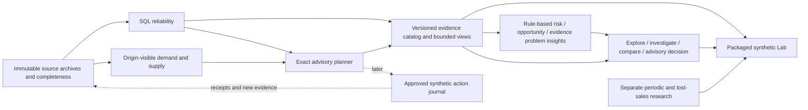

# Next implementation phases

Investigated 2026-10-12 (America/Los_Angeles), against main `b5b8d5a`.
Direction revised 2026-10-13 from the user's product-intelligence/UX guidance.
Status: **Increments 0–4 implemented and locally accepted on 2026-10-13**.
The subsequent user assignment authorized these product increments under AUTO,
including necessary engineering. The automation now assigns integrated acceptance and Increments 3–4 with frozen
synthetic studies. Operational data and public/paid deployment remain excluded. [STATE](STATE.md) owns scope; [PLAN](PLAN.md) retains the unfinished
engineering confirmation protocol. This is the single pending product roadmap;
completed findings belong in [KB](KB.md#next-phase-investigation), measured results
in [RESULTS](RESULTS.md), and reference metadata in
[repositories.json](research/repositories.json).

## Recommendation and priorities

Build an **Inventory Decision Intelligence product**, beginning with a synthetic,
read-only **Inventory Decision Journey**: Overview → Explore → Investigate →
Compare → Decide. The system should proactively show what deserves attention,
explain why, expose the evidence and help the user compare feasible responses.
Detect risks and opportunities as well as evidence problems; a useful business
insight need not be a validation failure.

Keep the technical route and original O01–O22 opportunities. Add O23–O25 as product
goals composed from those capabilities, not independent large services. Bring
O06, lightweight O17/O18 and O20 into the first integrated experience. External
inventory products are useful functional/interaction references; overlapping
features are not a reason to limit this personal project's ambition. Data rights,
confidentiality, licenses and honest capability claims remain separate boundaries.

The system's strongest differentiator is evidence-gated decisions and inspectable
explanation, not the number of forecasting models. Preserve SQL-first reconciliation,
exact pieces/rationals, source identities, business/knowledge clocks, independent
oracles and append-only results. Keep the public synthetic replay separate from a
future authenticated operational application.

Use two coordinated tracks: **engineering** (reliability, exact evidence, performance
and evaluation) and **product** (insights, exploration, comparison and user journeys).
Each increment improves one complete journey and only the engineering needed to
make it correct. Do not mechanically implement the opportunity list in ID order.
Unrelated JIT, x86, serial1000 or full evidence-v2 completion must not block a
bounded local UI prototype; public/runtime claims and large-report support retain
their own gates. Correct arithmetic, complete evidence for the selected claim,
explicit clocks and fail-closed behavior are never optional.

Priority means recommended sequencing, not current authorization. Effort is a
relative planning estimate: S = one focused delivery; M = several connected
deliveries; L = a separately scoped phase. It is not a measured calendar estimate.
Dependencies below name the minimum needed slice, not completion of an entire
opportunity. O06/O17/O18/O23 share one catalog/insight contract and can be delivered
together; the table is not a serial backend-before-frontend execution order.

| Priority | Opportunity | Value / confidence | Effort | Dependencies |
|---|---|---|---|---|
| Now / highest product | [O06 Multi-item workbench](#o06-multi-item-workbench) | Explore actual dimensions and relevant decisions | M–L | O03 minimum read path/O05/O23; synthetic catalog |
| Now / product | [O23 Insight discovery and prioritization](#o23-insight-discovery-and-prioritization) | Proactive risk/opportunity/evidence highlights | M | O06; validated saved results and versioned rules |
| Now / product | [O05 Lab clarity and navigation](#o05-lab-clarity-and-navigation) | Understand and compare existing capabilities | S–M | Preserve current API/kernel; O24 labels |
| Now / product | [O24 Decision comparison experience](#o24-decision-comparison-experience) | Connect insight to supported what-if response | M–L | O05/O06; action-specific capability gates |
| Now / light slice | [O17 Evidence Copilot in the workbench](#o17-evidence-copilot-in-the-workbench) | Explain the selected insight offline | S–M | O06/O23; explicit evidence/calculation selection |
| Now / light slice | [O18 Apparel and lifecycle analytics](#o18-apparel-and-lifecycle-analytics) | Style/color/size availability, not only SKU totals | S–M | O06; complete key-level evidence; lifecycle later |
| Now / every increment | [O20 Portfolio and bounded release](#o20-portfolio-and-bounded-release) | Demonstrable journey; public release separately gated | S–M | Local journey acceptance; O01/O04 before hosting |
| Now / engineering track | [O01 Serving failure boundaries](#o01-serving-failure-boundaries) | Measured public-runtime release blocker | S–M | Existing PLAN; not a local prototype prerequisite |
| Now / engineering track | [O02 Planning latency](#o02-planning-latency) | Measured bottleneck; isolated comparison | S | Fresh bounded assignment; not a UI prerequisite |
| Now / minimum then expand | [O03 Scalable evidence access](#o03-scalable-evidence-access) | Bound the selected journey; fix large reports separately | M–L | Current-sized validation first; additive v2 later |
| Now / engineering track | [O04 Budgets and observability](#o04-budgets-and-observability) | Predictable journey failures | M | Envelope for the chosen local/hosted surface |
| Now / scoped support | [O07 Delivery and developer experience](#o07-delivery-and-developer-experience) | Reproducible packaging and journey checks | M | Separate historical/current validation |
| Next / history slice | [O25 Inventory history and trend exploration](#o25-inventory-history-and-trend-exploration) | New/persistent/improved insights across cutoffs | M | Two comparable saved cutoffs; O06/O23/O21 minimum |
| Later / P2 | [O08 Immutable input staging](#o08-immutable-input-staging) | Repeatable source onboarding | L | Data authorization; new adapter contract |
| Later / P2 | [O09 Exception review workflow](#o09-exception-review-workflow) | Close the investigation loop | M | O06; reviewer identity/auth |
| Later / P2 | [O10 Actual planner closed loop](#o10-actual-planner-closed-loop) | Tests what actual proposals do | M–L | Recover committed protocol; feature scope |
| Later / P2 | [O11 Supplier and purchase lifecycle](#o11-supplier-and-purchase-lifecycle) | Proposals become traceable commitments | L | O08/O10; durable action journal |
| Later / P2 | [O14 Count and quality workflow](#o14-count-and-quality-workflow) | Physical stock evidence, not ledger alone | M–L | O09/O08; existing count kernel |
| Later / P2 | [O21 Stronger provenance and replay](#o21-stronger-provenance-and-replay) | Audit changing inputs and deployed bytes | M | O08; authenticated producer boundary |
| Later / P3 | [O12 Supplier calendars and capacity](#o12-supplier-calendars-and-capacity) | More realistic feasible replenishment | L | O11 and explicit constraint semantics |
| Later / P3 | [O13 Multi-location transfers](#o13-multi-location-transfers) | Use existing surplus before buying | L | O11; transit/reservation contract |
| Later / P3 | [O15 Forecast and service intelligence](#o15-forecast-and-service-intelligence) | Decision-aware uncertainty | L | O10/O16; new frozen evidence |
| Next research phase | [O16 Decision-quality evaluation](#o16-decision-quality-evaluation) | Test actual proposal outcomes before more models | M–L | O10; new assigned study; O24 comparison contract |
| Later / operational gate | [O19 Identity and tenant isolation](#o19-identity-and-tenant-isolation) | Mandatory before real multi-user data | L | Defined users, tenancy and threat model |
| Later / optional | [O22 Larger frontend redesign](#o22-larger-frontend-redesign) | Useful when screens/state justify it | L | O06 API/view-model contract; UX validation |

## Verified baseline and limitations

The following observations belong to the October 12 investigation. This October 13
revision changes product priorities and planned increments, not their evidence or
the current implementation. New capabilities and illustrative supplier/style counts
in the user's direction are not accepted project results.

- Remote main matched local `b5b8d5aa856d03a27b5fdb3a105aca600e2595e9` after
  fetch. The only additional local branch is `codex/planner-closed-loop`, with two
  unmerged commits; the remote advertises only main. Integrated archive tags are
  historical pointers, not unfinished product branches.
- Core: `reliability.run_checks` executes parameterized SQL and atomically appends
  results in Repeatable Read. `read_series` replays origin-visible revisions and
  complete daily accepted-order evidence. `run_plan` revalidates inventory and
  requires complete supply; `project` performs exact prefix arithmetic and pack/MOQ
  rounding. The source schema deliberately admits invalid raw business records.
- Research already includes periodic backlog simulation, intermittent methods,
  warmup, safety retention, supply/policy contrasts, observed-sales adaptation,
  lost sales and physical-count corroboration. These are integrated research
  capabilities, not missing algorithms or operational workflows. There is no
  supported global model/policy champion or demonstrated commercial savings.
- Lab: one fixed synthetic SKU/warehouse, mean model, constant declared future,
  two evidence cases, ten integer controls. It evaluates `project` and a distinct
  periodic simulator; neither executes a real purchase. API requests reread and
  validate the archive, then `evaluate` validates its copy again. Repeated work
  exists; its CPU share has not been measured separately.
- Fresh focused checks: 34 Lab/API/hosted tests passed, plus six independent API
  controls. Clean/spike/delay proposals were 12/18/12; delayed immediate fill was
  `11/28`; incomplete supply produced null outputs; zero demand/zero reservations
  had undefined fill and cost 490. Source digest stayed unchanged.
  [Investigation receipt](review/next-phase-investigation.json).
- The current desktop UI was inspected at 1280×720; the demand preset and stale
  feedback worked. First metric cards begin at approximately document y=671px.
  A requested 320px override still reported effective width 1280, so no fresh
  mobile acceptance is claimed. Prior mobile/keyboard evidence remains in RESULTS.
- Retained performance: native 100k reconciliation median 10.251→0.856s, 12 samples
  per variant; ARM64 Linux selected-plan median 3.055s, 30 calls. Separate JIT
  diagnostic: 2.134/2.166s compilation. Serial100 completed in 77.958s; serial1000
  remains unmeasured. These are different environments/workloads.
- Retained evidence growth: eleven 730-day backtests persisted correctly at about
  63.84–64.62 MB but exceeded the 16 MiB reader. Two dense reliability reports at
  about 6.94/8.39 MB exceeded the 2 MiB reader. Dense duplicate/all-grain discrepancy
  producers also hit the 55s SQL deadline. Paging a UI alone fixes neither producer
  cost nor the whole-report validator. [Continuation](RESULTS.md#engineering-continuation).
- One continuous HTTP campaign passed 2700/2700 at offered 1.5/s; the three-campaign,
  route sample-floor, x86/two-date, human and public-TLS gates remain open. Proxy
  slow-body requests closed/returned 504 instead of required 408. Public hosting
  is absent. Existing Linux resource/crash evidence must not be called unmeasured.
- GitHub branch-protection read returned 401; public ruleset enumeration returned
  an empty list. Legacy protection/enforcement remains unverified. No vulnerability
  scan, fresh PostgreSQL acceptance, full suite or load campaign ran in this review.

## Architecture direction

Keep a modular Python/PostgreSQL application. Add bounded read models and versioned
workflow journals around the kernels; no service split is justified by current
measurements. The deployed synthetic Lab can remain stateless and database-free.

The dotted loop is proposed future work. It needs decision/action/receipt identity
and its own approval boundary; simulator metrics cannot establish that loop today.
Prefer SQL indexes, transaction-scoped reuse, normalized evidence and explicit API
contracts before queues/caches. Immutable identity includes source digest, cutoff,
known-at, contract and code/policy version; a SKU or run label alone is not a cache key.

## Now: engineering and product foundation

### O01 Serving failure boundaries

**Value/evidence:** required for a credible hosted demo; slow-body proxy failure and
remaining continuity gates are recorded, not hypothetical. **Approach:** reproduce
one bounded slow/chunked/oversized/disconnected body case through actual Caddy and
Uvicorn; trace which layer owns the five-second deadline. Make the smallest proxy
or wrapper change. Preserve 413/422/429/503 distinctions and last-successful UI
results. Finish only missing HTTP cells using the repaired wall-clock guards and
request journal, with reviewed runtime/budget; reuse completed receipts.

**Dependencies:** existing PLAN; actual proxy/container runtime. **Risks:** an inner
ASGI 408 cannot fix a proxy that has already closed the connection; changing the
expected outcome requires an explicit supported contract revision, never relabelled
old evidence. **Success:** declared body outcome/deadline is observed end to end,
with no admitted scenario calculation, source change or leaked exception. Every
required stability cell has its own complete denominator or stays explicitly open.
Do not delay local UX work on an unavailable x86 host or claim that gate passed.

### O02 Planning latency

**Value/evidence:** selected plans miss the proposed one-second median on ARM64;
saved profiles identify JIT compilation, and `_inventory` rechecks a whole batch
for each key. **Approach:** first compare default JIT with transaction-local JIT
disabled on the exact retained workload and one fresh confirmation workload.
Counterbalance order, retain compilation/CPU/latency and semantic/source hashes.
Keep prepared/generic-plan behavior explicit; [PostgreSQL 17 guidance](https://www.postgresql.org/docs/17/jit-decision.html)
supports the overhead hypothesis, not a promised speedup. If justified, apply the
narrow setting at the owned transaction boundary. Batch reuse is a separate change:
one coherent inventory validation per immutable batch/snapshot, key-specific
demand/supply and independent reports, with no cross-transaction trust cache.

**Dependencies:** new bounded optimization assignment; existing independent oracle.
**Risks:** JIT can benefit larger queries; reuse can conceal source-owner changes.
**Success:** identical statuses/quantities/evidence and unchanged sources; paired
gain with no declared larger/dirty-cell regression; selected-key SLO met on the
tested runtime or an honest smaller supported envelope. Do not bundle indexes,
JIT and cache changes into one uninterpretable benchmark.

### O03 Scalable evidence access

**Value/evidence:** legitimate reports exceed consumer caps; repeated raw training
and source records in folds grow history. **Approach:** first provide the bounded
summary/detail/inspect path needed by the selected O23/O24 journey, using complete
currently readable reports and immutable references. This does not require all
large-report work to finish before UI exploration. When that journey exceeds the
existing envelope, design additive evidence-v2
with immutable source bundles, a small result/summary manifest, complete record
counts/digests and bounded evidence pages. Separate whole-run semantic validation
from bounded retrieval of already validated material. Persist validation/version
receipts atomically with a published manifest; resolve every reference to retained
bytes. Keep v1 readers/caps for v1 history. For reliability, profile defect/source
joins separately: producing one huge JSON then slicing it is insufficient.
Define a synthetic read API for list/detail/evidence with opaque stable cursors,
allowlisted sort/filter fields and maximum page/body limits; no arbitrary SQL.

**Dependencies:** frozen representation/validation contract and recovery plan.
**Risks:** incomplete pages masquerading as complete evidence; broken source links;
changed hashing; JavaScript loses integers above `2^53−1`. Use decimal strings for
wide pieces and rational strings at the new transport boundary; chart coordinates
may be approximate but exact tables/citations cannot be.
**Success:** the first journey can inspect all evidence supporting its selected
claim without mistaking a preview for complete evidence. Expanded acceptance:
saved 730-day and dense-report use cases are inspectable in bounded
pages without truncation, rewritten historical reports or raised v1 caps. Missing,
duplicated, reordered or altered chunks reject; complete counts and independent
scores/quantities agree. Measure total storage, producer time and reader memory.

### O04 Budgets and observability

**Value/evidence:** production core connections do not set the benchmark's 55s/5s
SQL/lock limits; hosted calculation is synchronous, logs omit access and no
application metrics/readiness route is defined. **Approach:** configurable bounded
core deadlines with explicit execution-error records separate from business runs;
redacted request/run correlation, duration, status, rejection, evidence-version and
body/deadline counters. Distinguish process liveness from evidence readiness;
health polling should not consume user allowance or run full scenarios. Record
image/commit/archive identity at startup. Define rollback and unhealthy-live-process
handling before introducing an automatic restart loop. Retain the single-worker
global limiter until a distributed admission design is actually needed.

**Dependencies:** supported envelope and O01. **Risks:** a request timeout does not
stop a worker thread or DB query; retries may duplicate appended reports; labels
can leak sources or create unbounded cardinality. **Success:** injected lock wait,
slow query, disconnect, invalid archive and crashed process produce bounded,
diagnosable outcomes with no partial business history. Metrics distinguish blocked
decisions, overload and internal faults. Recovery remains observed per fault until
a separately justified RTO/RPO is established.

### O05 Lab clarity and navigation

**Value/evidence:** first results nearly fall below a 720px viewport; ten controls,
eight equally weighted metrics, long scroll and raw JSON traces create cognitive
load. **Approach:** keep vanilla JS, existing assets and API for an incremental
delivery: compact heading/context; three primary decision/service/exposure values;
expandable economics and exact denominators; grouped advanced controls; linked
timeline/trace; prominent blocked reason and next evidence needed. Label declared
lead time separately from hidden physical delay. Move the service threshold to
comparison settings because it does not set safety. Add stable local scenario
links bound to archive/version and validated bounds, plus accessible reset/retry.

**Dependencies:** existing Lab contract; recommendations in
[UI direction](#ui-direction-and-reference-comparison). **Risks:** concise labels
can blur two policies, cost windows or undefined rates. **Success:** retain the
12/18/12 controls and null behavior, original archive identity, keyboard focus and
last-good response. Independent human walkthroughs should identify proposal,
simulator policy and blocker within three minutes without author help. Target
screen-reader, 200%/400% zoom, forced colors and narrow-screen checks against
[WCAG 2.2](https://www.w3.org/TR/WCAG22/); do not claim
WCAG conformance from automated checks alone.

### O06 Multi-item workbench

**Value/evidence:** schema already models styles/color/size and warehouses, but
`lab.KEY` and validator bind one item. There is no cross-dimensional inventory
explorer or proactive attention queue. **Approach:** make O06 the product shell for
O23 insights, lightweight O17 explanations/O18 matrices, O24 comparisons and O25
history. Export a bounded synthetic catalog from actual multi-key saved runs, with
summary → item/style detail → insight → supporting calculation/source drilldown.
Filters include style, color, size, SKU, location, insight type/status and cutoff;
use stable pagination, exact on-hand/committed/incoming labels and selected-run links.
Provide preset and manual exploration with the same explicit filter state: At-risk
Stock, Excess Stock, Untrusted Evidence, and only when supported Supply Delays and
Transfer Candidates. Include a Scenario Lab entry. Saved/shareable local views bind
filter schema and source/archive version; links do not grant access or promise live
refresh. Unsupported lifecycle or sales presets wait for the required data/rules.

Show unknown totals as unknown, filtered coverage/denominators and assessable-zero
separately from blocked. Render recorded key-level reconciliation while retaining
the planner's global nonpassing-run gate; local clean keys do not override it.
Keep a later DB-backed reader behind the same view contract; a packaged public
demo need not expose a live operational DB.

**Dependencies:** O03 minimum read path/O05 and a versioned multi-key replay adapter,
O23 rules and lightweight O18 dimension mapping, not a relaxed
fixed-fixture validator. **Risks:** cross-key joins, misleading aggregates, changing
historical selection to latest data. **Success:** a synthetic 100-key/two-location
catalog can navigate a known duplicate, shortage, clean proposal and blocked supply
case plus a business opportunity that is not a validation failure; each value
resolves to the correct run/key/cutoff. Preset/manual views select identical records
for identical filters; style/color/size cells retain location/coverage context.
Bounded pages include filtered totals; independent stock/order quantities and
invalid cross-key selectors are checked. This is a proposed fixture size, not
current acceptance; the first vertical slice may start smaller with an explicit envelope.

### O07 Delivery and developer experience

**Value/evidence:** fresh-only SQL bootstraps, stringly typed reports, separate CI
and hosted dependency resolution, unverified protection and a TestClient deprecation
warning create predictable maintenance work. **Approach:** keep dependency pins;
use a reviewed reproducible constraints/lock path for CI and hosted packaging,
then address the warning in a separate compatibility update. Add additive versioned
SQL migrations before introducing persistent product tables, with populated-database
upgrade checks. Type public report/context boundaries first using stdlib typing or
existing Pydantic, avoiding a whole-repo rewrite. Add targeted lint/static checks,
an installed-wheel smoke and small browser journeys for stale/blocked/retry/export
behavior. Preserve pinned original source maps and full Git history for lineage.
Verify protected-main settings with authorized account access; change them only
under an explicit repository-administration scope.

**Dependencies:** O03/new schemas. **Risks:** dependency drift invalidates historical
reproduction; autoformatting research kernels creates noisy provenance drift.
**Success:** a clean documented install and populated-schema upgrade work; old
reports decode unchanged; browser and API boundaries are checked in CI; software
bill of materials and a reviewed vulnerability scan record versions/results.
No current CVE-free or branch-protection claim follows from this investigation.

## Inventory workflows, explanation and provenance

### O08 Immutable input staging

**Value/gap:** fixture loaders and the public research adapter are not operational
ingestion. **Approach:** define a synthetic CSV/JSON adapter first, with exact
schema/unit/timezone validation, natural identity, revisions, raw hashes, expected
counts and completeness receipts. Stage raw records separately from curated views;
retain duplicates/invalid rows and explicit rejection reasons. Publish complete
batch versions atomically with an active pointer; interrupted or incomplete intake
retains the last-good batch but marks its freshness. Choose late-update cursors on
knowledge/recording time, not effective time alone. No upload endpoint in the
anonymous public demo. **Dependencies:** new input contract, O19 before real users,
explicit data/source rights authorization. **Risks:** claiming completeness from a
row count alone, silently repairing rows, losing backdated changes. **Success:**
synthetic duplicate delivery, revised records, missing pages and interrupted intake
preserve identities/history and block bad new batches; old runs reproduce exactly.

### O09 Exception review workflow

**Value/gap:** findings have evidence but no assignment, investigation state or
resolution history. **Approach:** a separate append-only review journal keyed to
finding/run/source scope, with owner, reason, note, due date and superseding run.
States: open → investigating → awaiting evidence → reviewed; only new passing
evidence establishes resolved inventory. An acknowledgement cannot change a check
or approve stock. Link repeated findings by deterministic semantic scope without
discarding each original occurrence. **Dependencies:** O06, identity/audit boundary.
**Risks:** closing a task being mistaken for correcting inventory; correlation
across changed batches. **Success:** duplicate and missing-evidence journeys retain
original findings, show who owes the next action, and resolve only through a
correctly linked new run. Concurrent notes/updates have explicit ordering/conflicts.

### O10 Actual planner closed loop

**Value/gap:** current simulator orders differ from actual `run_plan` proposals.
The paused branch retains protocol `55f4170` and machine controls `538d29d`; its
registered `/private/tmp/ii-planner-closed-loop` checkout has no files/.git and is
prunable. Uncommitted scripts/adapter/fixtures/tests previously listed in STATE
cannot be assumed recoverable. **Approach:** recover the two committed blobs into
a fresh branch when assigned, compare with current contracts, and reconstruct
implementation from the seven frozen manual controls. Run real checker/planner/
saved validator on a disposable synthetic DB; append new batches at each review,
receive before review, retain FIFO backlog, hidden actual delay and visible ETA
updates. Admit decisions by scenario/key/origin, not random run UUID.

**Dependencies:** explicit feature resumption; restricted-runner/owner separation.
**Risks:** stockout days make the next 28-day training window ineligible and overdue
backlog blocks supply; the frozen protocol expects some persistent blocked paths.
This is a discoverable recovery-policy limitation, not permission to re-date debt
or override gates. **Success:** all seven independent outcomes, conservation,
duplicate-admission and no-future-leakage controls pass; costs include paid starting
stock and common closure. An in-memory single-caller journal remains research,
not exactly-once execution. Any recovery policy requires an additive contract and
fresh comparative evidence after these controls are complete.

### O11 Supplier and purchase lifecycle

**Value/gap:** inbound rows lack a supplier/PO/receipt lifecycle. **Approach:**
synthetic suppliers, supplier-SKU terms and purchase lines with proposed → reviewed
→ approved → confirmed → partially received → closed/cancelled states. Approval
creates a separate commitment, not physical stock. Retain promise revisions,
partial/short/damaged receipts and overreceipt review; receipts generate new source
events in the synthetic adapter. Store a durable decision/action journal with
unique idempotency keys and transaction boundaries; an external connector later
needs an outbox, acknowledgements and reconciliation of uncertain delivery.
Start with reviewed draft/export, not automatic real ordering.
**Dependencies:** O08/O10/O19 for authenticated operation. **Risks:** duplicate
purchases, lost acknowledgements, counting ordered stock as available, approvals
using stale stock. **Success:** one approved decision cannot create two commitments
under retries/concurrent callers; partial receipts preserve exact remaining units,
new stock reconciles, cancelled promises are excluded and crash recovery preserves
journal state. External delivery is not called exactly once without receiver proof.

### O12 Supplier calendars and capacity

**Value/gap:** integer calendar-day lead, MOQ and packs do not model supplier
availability, review cutoff, holidays, capacity or minimum order value.
**Approach:** version supplier-SKU calendars, order cutoffs, planned versus observed
lead times, effective terms and capacity. Start with one binding constraint, e.g.
an order after Friday cutoff arrives on the next working-day schedule. Quantities
remain exact; currency uses explicit decimal/rational rates and currency/date.
Show infeasible/partly allocatable requirements rather than a fabricated optimum.
Add OTIF and promise accuracy only after defining original/latest promise, due
units and right-censoring for open orders. **Dependencies:** O11 receipt history.
**Risks:** hindsight ETA leakage, few receipts masquerading as calibrated reliability,
mixing supplier capacity and warehouse availability. **Success:** independent
holiday/cutoff/partial-capacity controls, dated terms and metric denominators;
fresh paid cost/service contrasts before promoting a constraint-aware policy.

### O13 Multi-location transfers

**Value/gap:** v1 validates immediate paired transfer legs but has no transit time,
dispatch/receipt reservation or allocation objective. **Approach:** additive
transfer-v2 dispatch → in-transit → receipt → discrepancy events, with immutable
natural identity and source/knowledge clocks. Reserve origin stock at dispatch;
destination cannot sell transit stock. First compare a deterministic transfer-before-
buying heuristic with purchase-only on two synthetic sites, protecting origin
service and using transport/setup/capacity costs. Later consider shared procurement
budgets or allocation optimization if the heuristic demonstrably fails.
**Dependencies:** O11, location/calendar/commitment semantics. **Risks:** double
counting network stock and stealing stock needed at origin. **Success:** conservation
through partial receipt/cancellation/missing leg; no pre-arrival availability; no
origin-service regression under the frozen acceptance cases; paired paid network
cost/service outcomes. Preserve immediate-transfer-v1 evidence unchanged.

### O14 Count and quality workflow

**Value/gap:** `physical_count.evaluate` already handles blind independent observers,
recount, variance and reviewed adjustment evidence, but has no operational UI or
authenticated count intake. **Approach:** synthetic count sessions, freeze/context,
blind forms, independent recount, approval trail and variance queue. Keep proposals
and approved evidence separate from adjustment execution. Add quality hold/damaged/
return inspection disposition before calculating available stock. Begin with
read-only replay and count intake in a private synthetic application; barcode/bin
flows only after the count workflow is usable. **Dependencies:** O08/O09/O19.
**Risks:** inventing real physical truth from self-reported identifiers, reducing
on-hand twice for holds/reservations, confusing adjustment permission with execution.
**Success:** conflicting/single-observer counts require recount; stale/nonblind/
wrong-location evidence blocks; reviewer is independent; any later authorized
adjustment creates a traceable new event and reconciles without overwriting stock.

### O17 Evidence Copilot in the workbench

**Value/gap:** deterministic saved-run explanations and optional intent routing
exist in CLI; the Lab trace is not a conversational Copilot. **Approach:** bring a
lightweight deterministic explanation into the first journey: explain the selected
O23 insight, why it matters, applicable rule, calculation and missing evidence.
Use selected-run buttons for blocker, rounding and shortage before arrival.
Responses contain typed claims, exact citation links and supported next steps;
scenario-derived claims cite calculation nodes rather than stored baseline UUIDs.
This explanation adapter needs no LLM and is not an autonomous decision agent.
An entity selector chooses run/finding/SKU explicitly;
the model must not select records or invent arithmetic. Natural-language multi-step
comparison later gets a new bounded intent contract and fresh unseen matrix, with
separate intent, entity, evidence, numeric and refusal scores. No free-form SQL.
**Dependencies:** O03 minimum/O06/O23; calculation nodes for derived claims. Rich
conversation and cross-run explanation follow O24/O25 rather than block the light slice.
**Risks:** source identity being presented as current authority, stale answers,
prompt injection and consumed holdout tuning. **Success:** works offline; invalid
selectors/cross-key questions fail closed; no source/action writes or new proposed
quantity; explanations cite exact selected evidence. Optional model calls require
their own budget/configuration decision and never become the calculation layer.

### O21 Stronger provenance and replay

**Value/gap:** retained hashes/lineage are strong reproducibility evidence; upstream
owners can still change inputs, and caller-provided `code_version='dev'` is not a
verified deployed code identity. **Approach:** ingestion-owned immutable manifests,
content-addressed source retention, effective/recorded/observed clocks and deployed
build identity. Introduce a bitemporal as-of/known-at run comparison showing added/
changed/removed source evidence, policy version and resulting quantities. Retention
must preserve bundles referenced by any retained run. Signed producer attestations
are conditional on a real producer trust/key-rotation model, not a default hashing
upgrade. **Dependencies:** O08 and source ownership. **Risks:** treating a hash or
signature as business truth; deleting shared evidence during retention cleanup.
**Success:** an owner mutation or missing referenced bundle is visible and cannot
reuse an old pass; original runs replay at original clocks; build and source
identities are independently checkable. Historical artifacts remain untouched.

## Decision quality, apparel intelligence and private operation

### O15 Forecast and service intelligence

**Value/gap:** operational runtime uses three point baselines; intermittent,
quantile and safety research exists but has not earned promotion. Lab demand
multiplier changes both training and future via ceiling, so it tests a coherent
counterfactual, not an unexpected future-only shock. **Approach:** separate history
shift, future shock, supplier information and physical delay in a Lab-v2 adapter.
Expose existing methods as labelled research comparisons before adding models.
For operational proposals, define cumulative lead+review demand uncertainty and
training-only calibration; evaluate coverage/pinball alongside achieved fill,
cycle service, paid inventory and infeasibility. Segment by training-known demand
pattern with explicit low-sample/null outcomes. Add intermittent or pooled models
only against a repeated sealed baseline weakness. [StatsForecast](https://github.com/Nixtla/statsforecast)
is a possible Apache-2.0 challenger library, not the next mandatory dependency.
**Dependencies:** O10/O16, fresh assigned traces/data rights. **Risks:** nominal
coverage mistaken for inventory service, post-holdout selection, sales censoring,
calendar drift and forecast surprises leaking into planning. **Success:** unseen
paired decision gains against mean and the selection-chosen baseline, no declared
service regression, valid denominators and full paid costs; otherwise keep baselines.

### O16 Decision-quality evaluation

**Value/gap:** substantial saved research supplies counterexamples, not validated
actual-planner performance or universal optimal policies. **Approach:** after O10,
freeze a small fresh matrix around one business question (e.g. notified versus
unannounced supplier delay and recovery), with disjoint selection/evaluation paths,
common settlement, paid starting/carryover stock and lost-sales/backlog contracts
kept separate. Independently calculate pre-receipt unfillable units, full cost,
service, terminal stock/debt, intervention effects and dependent denominators.
Include manual controls and an explicitly hindsight-only small oracle bound if
needed; that oracle never becomes planner input. Preserve no-winner outcomes.
**Dependencies:** new study authorization; O10; realistic synthetic economics.
**Risks:** an enormous grid becoming a substitute for a clear question; misleading
regret against an infeasible clairvoyant policy. **Success:** archived protocol before
results, independent quantities and saved-only audit, paired path-level summaries,
explicit evidence insufficient for promotion when appropriate. No new model is
required to complete this opportunity.

### O18 Apparel and lifecycle analytics

**Value/gap:** apparel styles/color/size exist, but no style-size availability,
assortment gaps, aged stock, monetary value or lifecycle workflow is exposed.
**Approach:** bring the light slice forward with O06: style → color×size availability
matrix, location/cutoff selector and drilldown to exact SKU/insight evidence. Show
zero separately from missing/untrusted cells; quantity colors need a stated rule
using demand, supply, location and horizon rather than arbitrary illustrative
thresholds. A large style total must not hide a missing size. Keep the existing
style/color/size identities and natural future lifecycle extension points.
Later add receipts/lot age and dated valuation
for inventory aging/turns/working-capital views; do not infer inventory age from a
current snapshot. Define slow-mover/retirement signals from known observations;
recommend transfer/markdown review before claiming a liquidation strategy. Returns
keep inspection/disposition evidence and cannot become negative accepted demand.
Promotions, substitution and new-product pooling require their own source features
and evaluation. **Dependencies:** light slice needs O06's complete SKU/dimension
mapping and O23 rules, not a new importer or PO system. Phase-out colors, size curves,
slow movers, location-specific demand, age and seasonality expand only when their
history/lifecycle/receipt features are available; the full slice needs O08/O11/O14
and economics/price evidence.
**Risks:** sums hiding missing sizes, overstated margin, unreliable ABC/XYZ thresholds
and applying an apparel rule to all products. **Success:** style totals equal exact
SKU totals only on complete coverage; missing sizes remain unknown; age/value bands
have independent controls; declining/recovering paths retain paid stock and service.

### O19 Identity and tenant isolation

**Value/gap:** anonymous stateless synthetic replay has an appropriate narrow trust
surface; it is not an authenticated multi-user operational product. **Approach:**
define owner/planner/reviewer/auditor permissions before adding private workflow
records. Use established authentication; tenant scope on every source/run/journal
and evidence lookup, with DB enforcement where appropriate. Separate ingestion,
result writer, reader and action executor roles. Add audit, secret rotation, backup/
restore and data-retention policies; treat browser request CSRF/session protection
according to the chosen auth flow. Keep real data out of anonymous demo paths.
**Dependencies:** actual user/deployment scope, O08/O11. **Risks:** merely adding a
login screen while evidence IDs remain globally readable. **Success:** cross-tenant
run/source/action identifiers deny access, approvals enforce independent roles,
secrets never enter response/log/build context and restore preserves isolation.
This is a prerequisite to real operation, not a reason to add auth to today's demo.

## Product intelligence and experience goals

The user's October 13 direction adds these goals to O01–O22. They reuse the
workbench, evidence and kernels; they do not imply three new backend services or
authorize implementation. External example counts, inventory matrices and sample
recommendations are illustrative, not measurements or existing planner outputs.

### O23 Insight discovery and prioritization

**Value/gap:** users should learn what deserves attention before knowing a question
to ask. Current validation findings identify evidence defects; they do not cover
every business risk or opportunity. **Approach:** a deterministic rule layer inside
the O06 read model, over validated saved results and explicitly scoped sources.
Use three types: **Risk**, **Opportunity**, **Evidence Problem**. Define rule version,
semantic insight identity, observation/run identity, SKU/style/location scope,
as-of/known-at/evaluated-at, applicability, trigger facts, exact exposure, source/
calculation links and supported next step. Separate a rule's business priority
from inventory validation severity; do not add/alter R001–R005 to manufacture risks.

First rule candidates: projected pre-arrival shortage; finite-window excess above
declared policy; incomplete/inconsistent evidence; supplier delay; demand shift;
and cross-location transfer candidate. Release only the subset with supporting
evidence. Current Lab delay is a hypothetical parameter, not observed supplier
lateness; demand-shift rules require complete comparable history windows; transfer
candidates require trustworthy origin/destination stock/obligations and remain
investigation opportunities until O13 supplies transit/capacity feasibility.
Excess is tied to demand, obligations, horizon and policy, not a stock-only threshold
or proof of obsolete inventory. Unknown evidence yields a problem/blocker, not a
fabricated shortage quantity, days-of-cover, money exposure or zero demand.

Prioritize with versioned interpretable tiers and explicit sort keys (urgency/date,
supported piece exposure, then stable identity); do not collapse incompatible units
into an opaque score. Highlight counts disclose eligible/blocked keys and coverage;
group repeated observations without dropping their history. Users can inspect the
rule/filter and choose manual exploration instead of accepting the default ranking.
**Dependencies:** O06's minimum catalog contract, O03 bounded evidence; O17 explains
the selected insight. O09 tracking and advanced actions are later slices.
**Risks:** false certainty from incomplete facts, double-counted SKU/style highlights,
look-ahead ranking and assuming all opportunities are feasible actions.
**Success:** independently specified synthetic risk/opportunity/problem controls
produce exact expected insight sets and deterministic order; a valid business
opportunity can coexist with passing reliability. Invalid/missing inputs suppress
unsupported quantities. Every highlight drills into its facts/evidence and identifies
the next review or missing evidence; no LLM discovers or calculates first-version rules.

### O24 Decision comparison experience

**Value/gap:** insight → explanation → evidence → suggested action → scenario
comparison is more useful than disconnected parameters and charts. **Approach:**
open a selected insight in the What-if Decision Explorer with its item/location,
recorded cutoff and baseline assumptions preserved. Compare supported alternatives
using deterministic kernels, clear feasibility/assumption status and exact metrics.
Keep baseline/edited/result state separate; show parameter diffs and retain the
last good response on error. The Decide step summarizes a supported advisory proposal,
tradeoffs, constraints and required human review; it does not approve/place orders.

| Comparison | Initial support / truthful presentation | Required extension |
|---|---|---|
| Do Nothing | Current prefix `balance_without_order` versus computed proposal balance; projection-only | Actual no-action service/cost needs a compatible executor/control in O10/O16 |
| Supplier Delay | Existing Lab hidden-delay scenario and separately identified periodic-policy outcomes | Observed supplier lateness/ETA updates need source and workflow evidence |
| Replenish Earlier | Declared lead-time what-if is an assumption, not proof of feasible earlier receipt | Supported ETA/calendar/capacity plus O10/O11/O12 before calling it feasible |
| Order More | Current proposal and rounding can be inspected; arbitrary 500-versus-700 execution is unavailable | Explicit action quantity, paid stock and common-window executor in O10/O16 |
| Transfer Stock | Investigate cross-location candidate facts when complete | O13 conservation/transit/donor protection before comparing realized service/cost |

Unsupported actions stay visibly unavailable with reasons; no mock result should
look like a kernel outcome. Do not compare an executed planner proposal with a
different simulator policy as if they were the same action. Common initial state,
scored/settlement windows, costs, policy and demand/supply path must be explicit.
If they differ, restrict comparison to compatible measures and explain differences;
disable unsupported savings/dominance claims. Preserve null service denominators.
**Dependencies:** O05/O06/O23 and O03 minimum; O10/O16 unlock actual decision-quality
comparisons, O11–O13 unlock action-specific feasibility. **Risks:** misleading causal
claims, free starting/transferred stock, hidden future supply leaking into planning.
**Success:** a user can inspect one stockout/delay insight, compare a currently
supported scenario and explain the result's policy/assumptions. A matched incomplete-
supply case blocks recommendations/comparison outputs correctly; every new metric
has exact calculation/evidence links. Later action controls independently establish
conservation, full costs and common-window service before richer options appear.

### O25 Inventory history and trend exploration

**Value/gap:** users need to see whether an insight is new, persistent, worse or
improved, rather than repeatedly inspect isolated snapshots. **Approach:** compare
immutable saved reports at explicitly selected cutoffs/knowledge times. Reuse O06
filters and O23 semantic scope to link observations; show quantities, recommendation,
rule/status and evidence changes. Keep item/location/unit, coverage, policy/model
version and calendar comparability visible. Separate business change from new
knowledge/revision or changed rules. A newly missing report is unknown, not resolved;
only sufficiently complete comparable evidence supports an improvement conclusion.
Start with two or three authored synthetic cutoffs and a bounded read-only timeline;
no new importer or wholesale provenance platform is needed for that slice.
**Dependencies:** O06/O23 and retained run/source bindings; O21's minimum as-of/
known-at semantics. Full O21 producer attestations and O08 ingestion remain later.
**Risks:** survivorship bias, history rewrite, aligning different horizons as one
trend and replaying later knowledge into earlier insights. **Success:** independent
new/persistent/worsening/improving/unknown controls, exact compatible deltas, unchanged
original report hashes and strict historical selectors. Future revisions cannot
alter the original historical view; noncomparable observations explain why a
numeric trend cannot be assessed. No population trend or efficacy claim follows.

## UI direction and reference comparison

Primary sources and public pages were checked during this investigation; repository
star counts are GitHub API snapshots, not quality scores. Exact inspected default-
branch SHAs and time are stored in the `next_phase_ui_review` block of
[research metadata](research/repositories.json). These are documentation/metadata
and targeted visual reviews, not complete upstream audits. Pin versions and inspect
the particular copied component's license/dependencies before adoption.

| Reference | Concrete pattern to adopt | Comparison / adoption boundary |
|---|---|---|
| [Linear filters](https://linear.app/docs/filters), [custom views](https://linear.app/docs/custom-views) | Dense attention queue, reason/status/location filters, shareable URL state, list → selected detail | Better for daily triage than a chart-first homepage. Borrow interaction vocabulary; proprietary UI/assets are not a code source. |
| [Shopify inventory states](https://help.shopify.com/en/manual/inventory-and-locations/fundamentals/inventory-states) and [PO receiving](https://help.shopify.com/en/manual/inventory-and-locations/purchase-orders/creating-inventory-transfers) | Explicit on-hand/available/committed/incoming labels; ordered units separate from receipt | Practical inventory vocabulary. Do not import its treatment of safety/quality holds without this project's own contracts. |
| [InvenTree stock](https://docs.inventree.org/en/stable/stock/) / [repository](https://github.com/inventree/InvenTree), 7,703 stars / MIT | Stock traceability, location detail, preview panels and purchasing links | Strong domain reference; retain our exact/time-aware kernel rather than importing its Django backend. Counts are not inherently authenticated truth. |
| [shadcn dashboard block](https://ui.shadcn.com/blocks?category=dashboard) / [repository](https://github.com/shadcn-ui/ui), 125,458 stars / MIT | Sidebar, accessible disclosure/dialog, compact detail layouts and owned component code | Good components for a later React shell. The generic equal-KPI-card dashboard should not determine inventory priorities. |
| [shadcn-admin live Tasks](https://shadcn-admin.netlify.app/tasks) / [repository](https://github.com/satnaing/shadcn-admin), 15,716 stars / MIT | Observed search, status/priority filters, column controls, paginated task table and compact sidebar | Closest practical workbench reference. Vite/TypeScript/TanStack architecture fits a static SPA; don't inherit demo auth, chats, users or irrelevant screens. |
| [TanStack Table guide](https://tanstack.com/table/latest/docs/guide/client-side-vs-server-side) / [repository](https://github.com/TanStack/table), 28,485 stars / MIT | Controlled server sorting/filtering/pagination, typed row models | Headless table logic, not data fetching/backend processing. Virtualization reduces DOM cost, not bytes/producer work; accessible paginated tables first. |
| [Radix introduction](https://www.radix-ui.com/primitives/docs/overview/introduction) / [repository](https://github.com/radix-ui/primitives), 19,388 stars / MIT | Focus-managed dialog, tabs, popover and keyboard navigation | Useful base for shadcn components; check one implementation family consistently. Library use does not prove app accessibility. |
| [Metabase interactive dashboards](https://www.metabase.com/docs/latest/dashboards/interactive) / [repository](https://github.com/metabase/metabase), 49,635 stars | Click a summary or chart to open the filtered evidence behind it; preserve context | Borrow drillthrough. [Licensing](https://www.metabase.com/license) distinguishes AGPL OSS, embedding and commercial options; API SPDX was NOASSERTION. Do not embed/adopt its stack by default. |
| [ECharts features](https://echarts.apache.org/en/feature.html) / [repository](https://github.com/apache/echarts), 67,488 stars / Apache-2.0 | Event markers, linked timeline, tooltip, zoom and selectable series | Useful when longer/linked timelines outgrow current SVG. Modular local bundle only; exact tables remain authoritative. No dependency needed for today's 28-day lines. |
| [ERPNext reordering](https://docs.frappe.io/erpnext/auto-creation-of-material-request) | Warehouse-specific terms and material-request workflow before purchase | Business process reference, not permission to copy GPL ERP/accounting code or label heuristic reorder rules optimal. |

Recommended visual direction: retain the Lab's warm neutral background and restrained
green identity, then make the application denser and task-oriented. Use clear
typography, tabular numerals, explicit text states plus color, unobtrusive borders
and short labels. Keep the large introductory hero on a portfolio entry page;
operational pages should lead with context and the next decision.

Proposed information architecture follows one journey, not a list of backend modules:

1. **Overview:** automatic Risk/Opportunity/Evidence Problem highlights and a
   sortable attention queue. Explain the trigger and eligible/blocked denominator;
   a user should not need to ask Copilot what to inspect.
2. **Explore:** presets or manual style/color/size/SKU/location/status/time filters,
   list or apparel matrix, saved/shareable view state and item drilldown. Start
   with supported At-risk Stock, Excess Stock and Untrusted Evidence; enable Supply
   Delays/Transfer Candidates only when their rules/data exist. Scenario Lab is
   an entry point, not a substitute for discovering insights.
3. **Investigate:** selected insight → why it matters → exact stock/demand/supply
   facts → calculation/source evidence → suggested review. Put lightweight O17
   explanation beside the insight, not behind a separate technical Evidence tab.
4. **Compare:** selected item/insight opens the What-if Decision Explorer. Carry
   context into supported alternatives; label hypothetical assumptions, policy,
   feasible/unavailable actions, accounting windows and compatible metrics.
5. **Decide:** summarize the assessable advisory proposal or evidence blocker,
   tradeoffs, limits and human review needed. No implied order approval/execution.
   Link back to the exact comparison or to O09 follow-up when that workflow exists.

Evidence/run/research catalogs remain available for deeper inspection; sources
and calculation links must also be present at each journey step. O25 adds history
inside item/insight detail. Supplier/purchasing navigation appears with O11, not as
empty menus. These stages need not become five separate pages or services.

Make freshness and coverage visible at the overview, item, insight and comparison:
source as-of/known-at, last evaluation/generation, covered versus expected locations/
keys/days, missing sources, stale calculations and blocked recommendations. A new
generation time does not make an old stock cutoff fresh. Distinguish **source
completeness**, **recorded validation**, **rule applicability**, **forecast uncertainty**
and **action feasibility**. Use explicit states/reasons and measured denominators;
never invent a composite “AI confidence 92%” or calibrated probability. Forecast
uncertainty may be unavailable even when data is complete. Missing coverage must
remain visible when users filter to a subset.

Decision detail layout: compact top context (item/location, historical cutoff,
archive and status); decision/arrival/blocker on the first row; stock/demand/receipt
timeline in the main column; an evidence inspector alongside it on desktop and as
a full page on mobile. Selecting an event reveals its exact date, quantity, row/
calculation reference and assumptions. Use a side panel only for short inspection;
long history/comparison deserves a linked route. Costs show common scored windows
before total/runoff deltas; unequal exposure must remain visible.

Component inventory: context bar, status-with-reason, bounded filter toolbar,
accessible paginated table, key detail link, exact value/denominator disclosure,
timeline + equivalent table, apparel matrix with exact cell drilldown, insight
type/trigger/priority, evidence-context disclosure, change diff, trace inspector, stale-result indicator,
error/retry and download. Use a sticky primary action only when focus/zoom checks
show it cannot obscure content. Avoid ambiguous disabled controls; explain why.

### O22 Larger frontend redesign

**Value/condition:** justified by O06's multiple routes, reusable tables, inspector,
typed contracts and scenario/history state, not by aesthetics alone.
**Approach:** React + TypeScript + Vite static SPA; locally bundled chosen shadcn/
Radix components; TanStack Table for actual multi-key data; add Query/Router only
where their state/fetching responsibilities are needed. FastAPI remains the API
and static host. Exact rational/wide-integer transport is typed; no client business
arithmetic. Keep Python-only packaged-demo installation by shipping built assets
in the wheel; frontend tooling belongs to developer build/CI, not demo startup.
Use named design tokens and a few reusable page components; do not clone a template.

**Dependencies:** O06 read/view contract, reviewed package/version/license inventory,
browser and accessibility baseline. **Risks:** new build/dependency burden, invalid
state caches, CSP drift, loading all evidence for one chart, wholesale rewrite that
loses existing safeguards. **Success:** old independent scenario values still
agree; multi-route state/URLs/reload work; mobile navigation, keyboard, speech,
blocked/stale/retry/export journeys pass; explicit JS/bundle/network budgets are
frozen before migration and measured after. Incremental O05 is the immediate choice;
O22 becomes the choice when the multi-item workbench scope is accepted. Skip Next.js,
SSR, microfrontends and server actions for this same-origin static application.

### O20 Portfolio and bounded release

**Value/gap:** README already has a case study and screenshot; it has no public demo
and some early hosting paragraphs lag later verified container evidence.
**Approach:** refresh the maintained overview/hosting status from exact receipts;
provide a three-minute insight → explore → explanation/evidence → supported scenario
comparison → advisory/blocked decision walkthrough for each increment,
one architecture view and a compact claim/evidence catalog including negative
results. Record release commit, built image/dependency/archive digest, rollback
image and supported envelope. Add external uptime and redacted error monitoring
only after a reviewed host/domain/cost decision and end-to-end release checks.
Keep the local no-key/no-DB path available where the packaged slice supports it.
**Dependencies:** local demos follow the selected journey's correctness/UX checks;
O01/O04 and human cold-start/readability plus separate paid/public deployment
authorization gate hosting, not production of every local increment demo.
**Risks:** presenting synthetic performance as retailer impact; impressive counts
hiding test denominators; a public limiter being mistaken for DoS protection.
**Success:** independent readers can reproduce the example, explain the two
policies and identify limitations; each headline claim links measured evidence.
Public TLS/rollback/uptime are verified before describing a live deployed service.

## Skip or defer without a demonstrated trigger

- **New model zoo, LLM-generated quantities or autonomous purchase agent:** neither
  saved intermittent nor public-sales studies supports a universal promotion;
  arithmetic and approval must remain deterministic. Trigger: O15/O16 shows a
  repeated unmet baseline objective and a bounded challenger wins fresh evidence.
- **Kubernetes, Kafka, Redis, microservices, sharding, streaming-by-default:** no
  measured need; fix JIT/repeated reads/evidence shape before changing topology.
  Trigger: supported-envelope measurements expose a problem simpler remedies fail.
- **Full ERP, accounting/FIFO valuation, manufacturing/BOM, arbitrary units, lots/
  serials/expiry, warehouse robotics:** beyond finished apparel scope. Trigger:
  a named workflow with source rights and new quantity/cost/timing contract.
- **ML supplier scoring, global allocation/MILP and automatic safety selection:**
  receipt truth, constraints and a baseline objective must exist first. A small
  deterministic heuristic and explicit infeasibility are better first comparisons.
- **Charts everywhere, decorative maps, dark-mode/theme suite, copied admin starter,
  paid BI embedding:** do not solve the observed decision/triage gaps. Trigger:
  actual user task or accessibility requirement, measured with the chosen workflow.
- **Real imports, unapproved M5 mirrors, re-running consumed research, raising caps
  to hide failures:** retain current data/contract boundaries; these require an
  explicit new scope/rights/protocol decision, not automatic roadmap continuation.

## Delivery sequence and acceptance gates

These increments replace the October 12 backend-first Phase A/B/C ordering.
Original opportunities and benchmark evidence stay intact. Work both tracks within
each assigned increment; do not require completion of every engineering opportunity
before exposing a correct bounded experience. Each increment ends with a local
synthetic demo and its measured/unsupported capability boundary (O20).

### Increment 0 — product capability and experience review

**Delivered:** [capability/support map](DECISION_LAB.md#product-capability-and-experience-boundary),
[frontend decision](DECISIONS.md) and frozen [independent controls](product-contract.md).

**User outcome:** a concrete, feasible Inventory Decision Journey is ready to build.
Reuse the October 12 investigation; this is a targeted product capability/UX review,
not another broad backend audit. Map O06/O17/O18/O23–O25 to existing outputs and
identify adapter, rule, source-field and action gaps. Define one journey, small
synthetic fixture scope, exact expected insight sets, comparison capability matrix,
evidence-context contract and screen/state flow before implementation.

**Product track:** Overview → Explore → Investigate → Compare → Decide; prioritize
the first stockout/supply-delay insight and one evidence-blocked counterpart; plan
lightweight apparel/preset entry points. **Engineering track:** minimum O03 read
path, per-key/source binding, clocks, rule/calculation references and strict input
bounds. Existing projection/periodic outcomes keep separate labels. Decide vanilla
versus O22 based on accepted screens/state, not a preselected framework rewrite.
**Exit:** a field-by-field support/gap map, independent fixture expectations and
explicit acceptance for every journey state. Mockups/illustrative values are labelled;
no unsupported feasibility or realized action outcomes appear as existing results.
The October 13 implementation assignment authorizes this increment.
The frozen eight-key controls and 100-key expansion are in the
[product contract](product-contract.md).

### Increment 1 — first complete insight-to-decision journey

**Delivered locally:** complete read-only journey after independent eight-key controls,
with actual saved reports, exact insights, scoped evidence, supported scenarios and
blocked/advisory decisions. [Results and explicit gates](RESULTS.md#product-journey).

**User outcome:** opening the demo reveals a useful stockout/supply risk; the user
can investigate its evidence, compare a supported what-if and understand the
advisory decision or reason it is blocked. Start with a small declared synthetic
catalog including style/color/size and two locations; freeze its exact size before
coding rather than require the 100-key exploratory envelope up front.

**Product track:** O06 shell, initial O23 rules/attention queue, lightweight O17
explanation/O18 availability matrix, O05 clarity and O24 supported scenario flow.
Include Risk/Opportunity/Evidence Problem views, usable preset/manual filters and
visible freshness/coverage/applicability; ship a short O20 local demonstration.
**Engineering track:** actual saved synthetic source/results, independently checked
insight rules, minimum bounded complete evidence access, a versioned catalog adapter
and O07 journey checks. Add only O04 diagnostics required for clear failure/retry.
O01 release fixes and O02 isolated JIT work remain scoped engineering work alongside
the journey; x86/serial1000/full evidence-v2 do not block this local slice.

**Exit:** users complete all five stages; highlight/selection/matrix quantities and
calculation/source links match independent expected facts. A passing-reliability
opportunity is distinct from a validation failure. Incomplete evidence suppresses
recommendation and unsupported comparison values, retaining the last good result.
Existing scenario controls/null denominators and policy distinctions remain correct;
keyboard, stale/reset/error/retry/export paths work. No order/source writes or model
calls are needed. Independent comprehension checks are recorded separately from
developer checks; public or accessibility-conformance claims remain gated.

### Increment 2 — broader exploration, history and comparison

**Delivered locally:** 100 keys/two locations/three immutable cutoffs, apparel matrix,
manual/preset/saved/shareable views and compatible history deltas. Missing coverage
remains unknown. [Acceptance](EVIDENCE.md#product-journey).

**User outcome:** users explore styles and locations, revisit a saved view and see
whether an insight appeared, persisted, worsened or improved across cutoffs.
**Product track:** expand presets/matrices and lightweight O17 explanations; add
O25 two/three-cutoff history and O24 comparison context with compatible deltas.
Broader lifecycle/transfer presets ship only with evidence and explicit capability.
**Engineering track:** minimum O21 temporal/source bindings, stable insight/view
identity and version comparability; expand O03 producer/reader representation only
where the chosen history actually requires it. Then validate the intended multi-key
envelope, including the previously proposed 100-key/two-location case if assigned.
**Exit:** new/persistent/improved/unknown controls match independent expectations,
old report bytes remain unchanged, future knowledge cannot leak backward, missing
coverage cannot look resolved, and preset/manual/shareable selections agree.
Every demo explains compatible comparison windows and unsupported alternatives.

### Increment 3 — actual planner decision quality and feedback (delivered locally)

**User outcome:** comparisons can demonstrate what the actual planner's proposals
do, instead of relying on a different periodic policy. Prioritize O10/O16 before
additional O15 forecasting models. **Product track:** truthful Do Nothing/actual
proposal/alternative quantity comparison, with paid inventory, service, constraints
and common accounting windows; connect O09 follow-up to discovered insights.
**Engineering track:** recover O10's committed protocol and seven independent
controls, then characterize blocked recovery. Any altered recovery policy/action
executor needs an additive contract and fresh frozen O16 comparison; do not change
training/supply gates to make the demonstration succeed. O08/O11 durable synthetic
commitments/receipts and O21 replay follow the accepted feedback slice; an in-memory
journal is not a production executor. **Exit:** conservation, identity/idempotency,
hidden-information boundaries, full paid costs and fresh paired decision outcomes
are independently validated. No-winner/blocked outcomes remain valid findings.
Real imports/users/orders still require their own scope and O19 protections.

### Increment 4 — durable synthetic commitments and receipt feedback (delivered locally)

**Scope selected from Increment 3:** six original controls agree, one original cold
oracle needs the retained arithmetic erratum; 12 fresh paired stress traces have
36 independently audited cells. Stockout/overdue gates block recovery, and quiet
future demand makes Do Nothing cheaper than actual proposals. No universal winner.
The highest-value next slice is O11/O21 durable source-bound decisions, commitments,
truthful supplier ETA updates and partial receipts, rather than new forecasting or
unsupported transfers/lifecycle calculations.

**User outcome:** inspect actual execution and paid outcomes, compare paired policies,
then exercise a clearly labeled local synthetic journal with persistent identities,
partial receipts and remaining inbound. **Engineering:** SQLite transaction journal
separate from operational source archives, immutable events, idempotent admission,
non-backdated knowledge, exact receipt conservation, origin-visible supply projection,
and reopen/rollback controls. No real purchase, company input or stock-table writes.
The packaged default remains read-only; journal writes require an explicit local
sandbox configuration. A replayed research journal is not production exactly-once.

**Frozen acceptance before implementation:** admit clean day-0 proposal 12 once;
repeating it after reopen adds no order. At promised date March 9, receive 5 pieces,
leaving 7; notify March 10 ETA March 11; receive remaining 7 on March 11. March 8
snapshot has 12 pending and zero received; March 9 has 7 pending/5 received;
March 11 has zero pending/12 received. Repeating identical events is harmless;
conflicting IDs, unknown decision, blocked/zero order, 8-piece overreceipt after 5,
receipt before March 9, backdated notice/receipt, invalid/negative/fractional quantity,
and failed transaction leave last-good state unchanged. Supplier update does not
repair training coverage or create demand. A new immutable supply batch can be
published by the synthetic owner and revalidated by the real planner.

**Exit:** exact durable identities/conservation/history, actual saved execution browser
journey, offline wheel and local demo pass. Public runtime, PostgreSQL17 reference,
authenticated multi-user operational executor, real supplier adapters, deployment,
transfers, aged-stock/size-curve economics and new models remain separate future work.

### Gate ownership and next assignment

**Every local journey:** exact quantities, applicable rules, selected-source
completeness, explicit clocks/citations, null/block behavior and bounded failures.
UI prototype acceptance cannot waive these. **Large-scale support:** O02/O03 and
the specific PLAN cells measuring the claimed workload. **Public hosting:** O01/O04,
remaining runtime/recovery, host/domain/cost and public-TLS approval. **Real/private
workflows:** O08/O19, identities/approval/action contracts and explicit data rights.
Open gates do not imply failed unrelated local journey work or successful production.

**Current outcome:** Increments 0–4 are delivered within the synthetic/local envelope.
[Measured actual outcomes and feedback](PLANNER_EXECUTION.md) establish the specific
controls and stress grid, including the original oracle rejection and quiet-trace
counterexample. No universal winner is claimed. Next unassigned capabilities are
supplier calendars/capacity, donor-safe transfers and lifecycle economics, chosen
with new frozen evidence; real intake requires identity/data rights/action gates.
Independent human comprehension, accessibility, reference hardware and public
runtime remain open. Deployment is excluded from the present assignment.
